# NudgeMyInvoice

**The AI invoice assistant that helps freelancers get paid — across currencies, with humans in control.**


*Nudgey — the invoice companion (existing product artwork from
`apps/web/public/brand/nudge-logo.jpg`).*

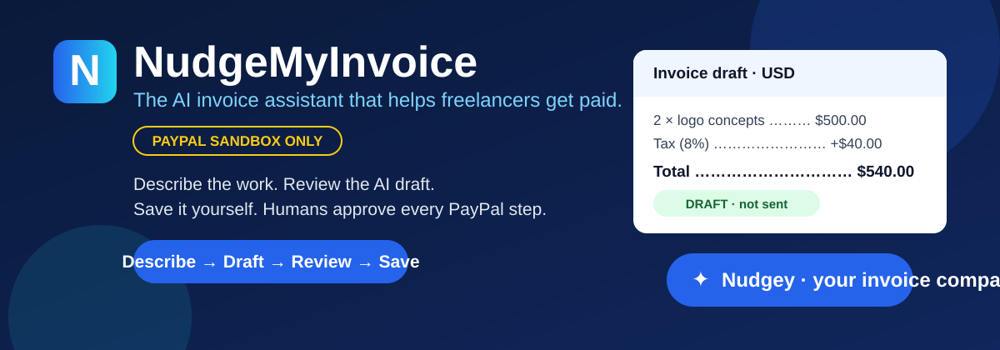

> **Hackathon MVP — PayPal sandbox only.** Not a production payment service. No live
> PayPal endpoints, no escrow, no automatic refunds, no autonomous sending or reminders.
> Nothing on this page moves real money.

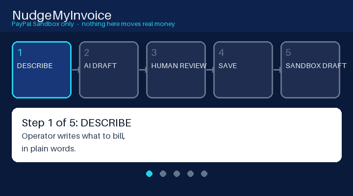

*The whole product in five steps: **Describe → AI Draft → Human Review → Save →
PayPal Sandbox DRAFT.** A static version of this diagram is
[flow-static.svg](docs/showcase/flow-static.svg) for readers whose browsers do not
play animations. The animation is an original illustration, not a screen recording.*

## Product showcase

Every screenshot below is genuine product output captured with synthetic demo data —
no stock imagery, no fabricated screens. Full QA records live under
[`design/evidence/`](design/evidence/).

| Screen | What it proves |
|---|---|
| 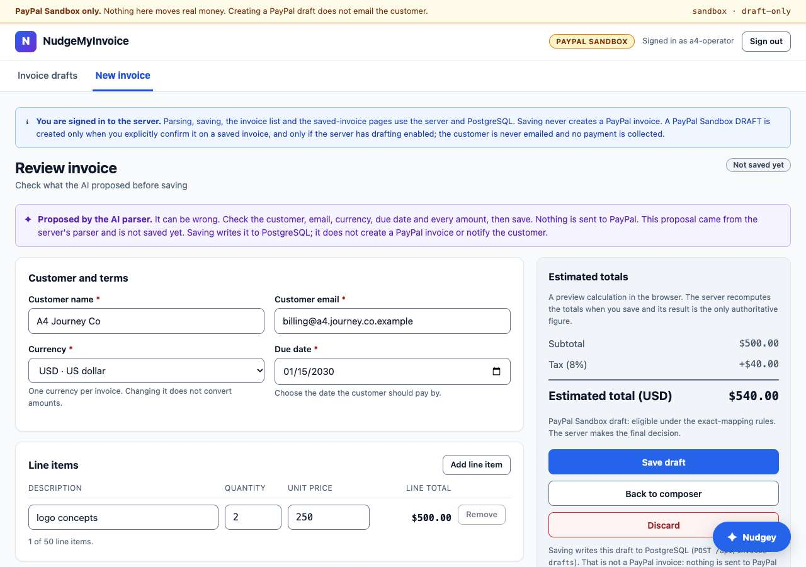 | **Invoice composer + human review.** The operator edits every field the AI proposed; the server recomputes totals and its result is the only authoritative figure. Nothing is sent to PayPal from this screen. |
| 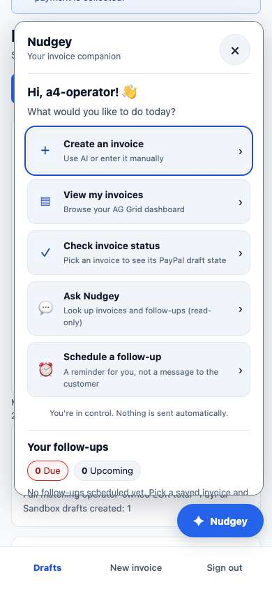 | **Nudgey, the invoice companion.** Navigation shortcuts, read-only invoice lookup and local follow-up reminders. Nudgey never sends anything — “You’re in control. Nothing is sent automatically.” |
| 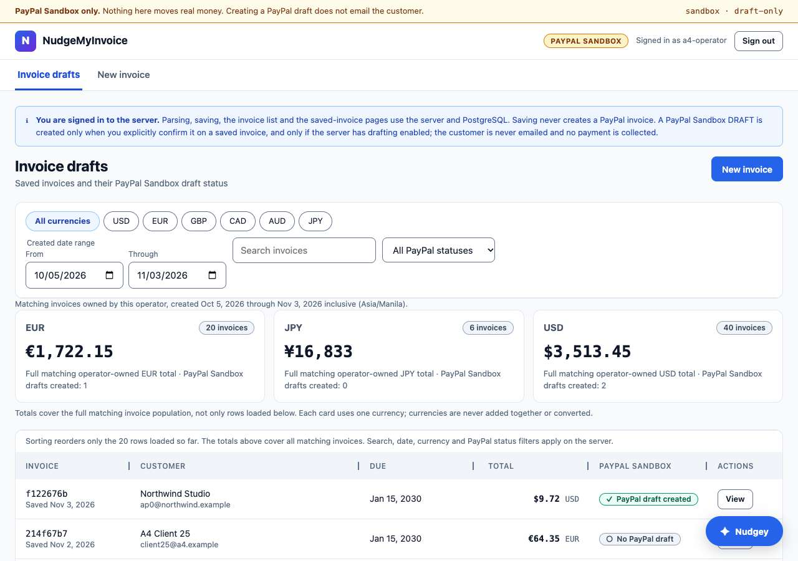 | **Invoice dashboard.** Owner-scoped list with server-side search and filters, per-currency totals (currencies are never added together or converted), and a real AG Grid Community table. |
| 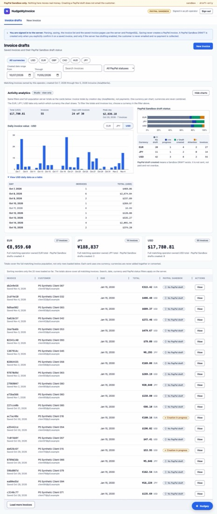 | **Licensed AG Studio analytics.** View-only charts drawn from the same server totals as the cards (resized copy of the P5 licensed-production QA capture; synthetic data). Local licensed-chart rendering is verified; the Live runtime check is pending. |
| 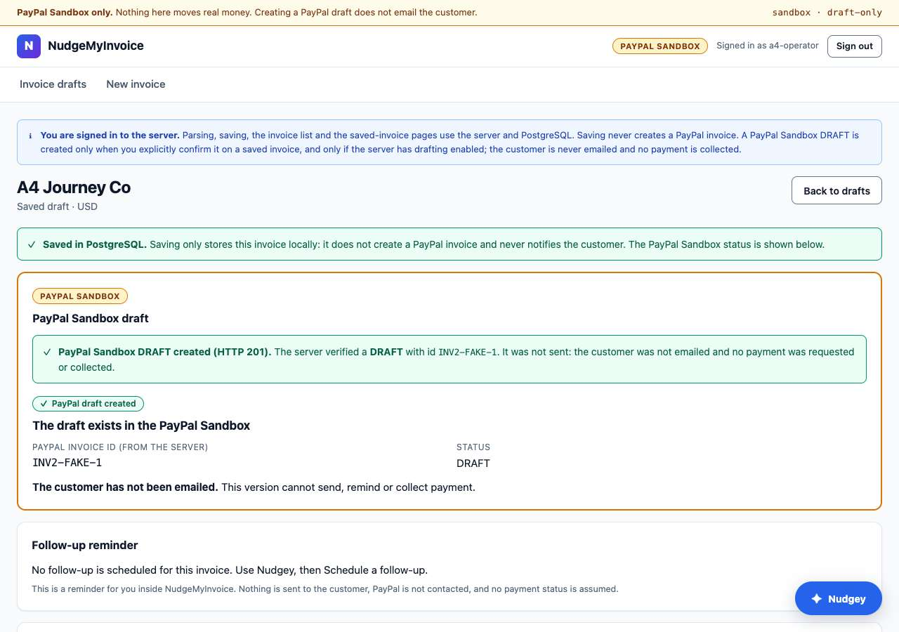 | **PayPal Sandbox draft UI.** After explicit human confirmation, the server creates a Sandbox **DRAFT**, reads it back, and shows the verified draft ID and status. The customer is not emailed; no payment is requested or collected. |

Feature overview: natural-language invoice drafting with a clarification loop and an
always-available manual-entry fallback; OpenAI structured extraction whose output is
treated as untrusted until Zod and domain validation pass; integer minor-unit money
math with one currency per invoice; idempotent audited saves to PostgreSQL; an
explicit-confirmation PayPal Sandbox draft flow with a durable fenced state machine
(`pending → creating → created | rejected | unknown | mismatch`) and fail-closed
reconciliation; local operator follow-up reminders that are never customer messages.

## System architecture

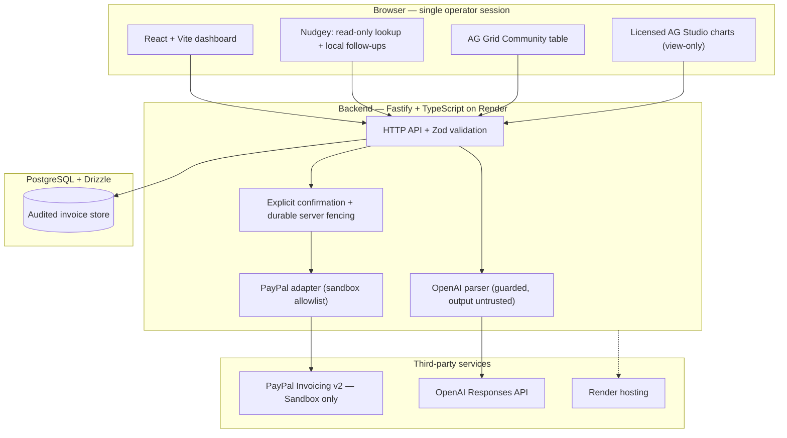

Role of each integration, honestly labelled:

- **PayPal (Invoicing v2, Sandbox only).** Draft creation only — one explicit human
  confirmation produces one Sandbox DRAFT, verified by read-back. Sending,
  reminders, payments and webhooks are not implemented; live hosts are refused.
- **OpenAI (Responses API, structured output).** Proposes invoice fields from plain
  words. Model output is untrusted input: Zod plus strict domain re-validation,
  server-side totals, and drafting disabled by default. One provisional real-API
  verification exists (see evidence); routine tests use a fake model.
- **AG Studio (licensed 45-day trial).** View-only analytics charts on the dashboard
  from the same server aggregates as the currency cards. Licensed rendering is
  verified locally; production runtime verification is pending. No endorsement by
  AG Grid Ltd. is implied.
- **Render (hosting).** Serves the existing Live combined deployment
  (`release/nmi-combined-judges-2026@766dde37`, tracking `main`, auto-deploy off);
  the previous candidate is retained only as a rollback baseline. No new paid
  resources are created by this repository state.

Dotted lines mark deployment relationships, not data flows. Disabled-by-default
paths (OpenAI drafting, PayPal draft writes) stay off unless an authorized operator
enables them per run; unverified integrations (Live Studio runtime, end-to-end
provider QA) are labelled pending in [evidence](#engineering-evidence), never shown
as done.

## Security by design

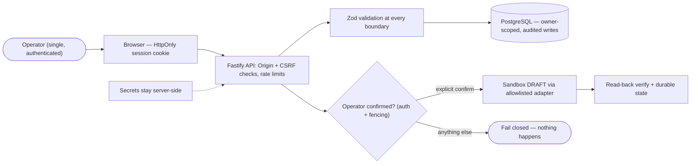

- **Server-side secrets.** PayPal OAuth tokens and the OpenAI key never leave the
  server; sessions are HttpOnly cookies with Origin/CSRF validation on mutations,
  strict content security policy, and throttled logins.
- **Validation everywhere.** Zod schemas at all external boundaries; money is
  integer minor-units per currency (never floating point); one ISO 4217 currency
  per invoice with no FX and no mixed-currency totals.
- **Sandbox enforcement.** A hostname allowlist refuses live PayPal endpoints;
  drafting ships disabled (`PAYPAL_DRAFTS_ENABLED=false`).
- **Human-controlled PayPal drafts.** AI and background jobs may only propose.
  A Sandbox draft is created only for an authenticated operator (`requireOperator`
  with Origin/CSRF checks), after explicit browser confirmation, as a single
  request per confirmation through a durable fenced server claim with exact
  read-back verification. Privileged payment actions (`sendInvoice`,
  `sendReminder`, `refundPayment`, `cancelInvoice`, `markPaid`) and approval
  grants are **future, not implemented**: no grant issuer exists and no route
  consumes grants (see `docs/SECURITY.md`). The backend, not the prompt,
  enforces every gate that does exist.

  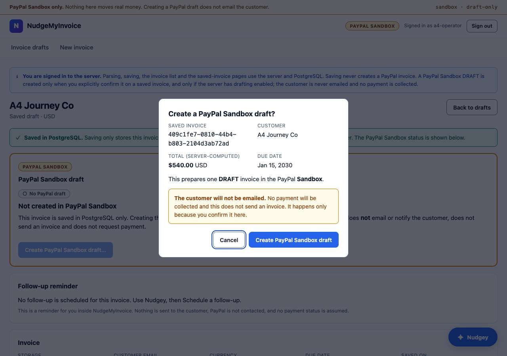

  *The confirmation gate in the product: no approval, no draft — the server fails
  closed. Ambiguity means refuse.*
- **Auditability.** Parameterized queries, redacted structured logs, durable
  operation fencing with exact remote verification, and a corrupt-backup negative
  control in the release drills. No raw card data anywhere. No secrets or invoice
  PII in repository files, demo screenshots, logs, or commits — but note that
  when OpenAI parsing is enabled, the operator's submitted invoice text (which
  may contain customer details) is sent to the model: minimize PII, prefer
  synthetic demo data, and know it is not persisted in audit logs.

## How we built it

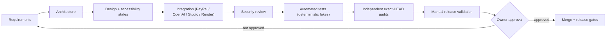

- **PayPal** gave us real sandbox invoicing semantics (draft lifecycle, exact
  remote verification) without ever touching live money.
- **OpenAI** gave us structured extraction from plain words, wrapped so tightly
  in validation that the model can be wrong without anything bad happening.
- **AG Studio** gave us licensed, view-only analytics over data the server
  already trusted — charts can mislead, so they only redraw server aggregates.
- **Render** gave us a single pinned, reproducible deployment target with
  rollback, tracked spend, and a teardown plan.
- **Evidence-backed development.** Every phase records its test objective, exact
  commit SHA, counts, environment, and residual risk in
  [`docs/STATUS.md`](docs/STATUS.md) and [`design/evidence/`](design/evidence/);
  independent auditors re-verify at exact HEADs before any owner merge; hosted CI
  gaps are disclosed as `NOT RUN`, never upgraded to `PASS`.

## Engineering evidence

Counts below are taken from [`docs/STATUS.md`](docs/STATUS.md) and the linked QA
records. **Implementer-recorded** means the implementation agent ran it;
**independently audited** means a separate reviewer verified it at the exact HEAD.
Simulated tests use deterministic fake providers and disposable PostgreSQL — they
are not real-provider acceptance.

| Area | Result | Attribution |
|---|---|---|
| Ask Nudgey browser QA (chat, status, follow-up, save-guard) | 195/195 synthetic, no providers | Independently audited PASS (PR #27); hosted CI PASS at `a3d5c4c` |
| Submission rehearsal R0 | Hosted CI PASS at `fc23aab`; simulated journey 32/32 | CI independently verified; journey implementer-reported |
| Licensed Studio production QA + dev QA | 43/43 licensed; 96/96 dev | Implementer-recorded (P5) |
| AI Nudge queue validation | 1,383 checks; 367 PG tests; 150/150 journey; 25/25 previews (fake model) | Implementer-recorded (P6) |
| Dashboard analytics integration | 235/235 focused; 142/142 transport; 96/96 PG; 12/12 browser QA | Implementer-recorded (A2) |
| Migration + journal acceptance | 1,432 unit; 367 PG16; 56/56 preflight; 21/21 migration-plan | Implementer-recorded (PR #51); hosted CI NOT RUN |
| Release-preflight suite (SHA-pinned gate + CLI proofs) | 115/115 | Independently rerun at `598b7bb` during the PR #72 audit |
| Real PayPal Sandbox smoke (2026-10-26) | One OAuth 200, one DRAFT create 201, one read-only show 200 (USD 5.00, fictitious) | Real provider execution; one-create budget exhausted |
| Real OpenAI parse, provisional (2026-10-30) | Two synthetic parses saved (USD 540.00, EUR 599.97); 0 provider-side writes | Owner-executed, single run; authorization consumed |

**Pending / not run:** Live Studio runtime verification; live end-to-end provider
QA; judge URL sharing. **GitHub-hosted Actions are unavailable until December
(external billing block)** — recent heads show hosted CI as `NOT RUN` with a
merged one-time manual-validation exception policy (PRs #71, #72). An unrun hosted
check is never presented as passed.

## Getting started

Full judge instructions: **[docs/NMI-DEMO-JUDGE-RUNBOOK.md](docs/NMI-DEMO-JUDGE-RUNBOOK.md)**
(historical Mode A browser QA and 2026-11-07 implementation-agent disposable
PostgreSQL 16.15 verification of the nine-migration §3–§5/§11 setup are recorded
there; independent review pending). Summary:

Prerequisites: Node ≥ 22, pnpm 10, PostgreSQL 16, a random `SESSION_SECRET`
(≥ 32 characters) and `DATABASE_URL`. No provider credentials are needed to run or
evaluate the app: without them parsing falls back to manual entry, PayPal drafting
is off, and a clearly labelled **SIMULATED evaluation mode** (test-only launcher,
no provider requests) runs the whole workflow.

Create a **throw-away** PostgreSQL 16 `nmi_judge` database and set `DATABASE_URL`
by following **[runbook §3–§4](docs/NMI-DEMO-JUDGE-RUNBOOK.md)**. Those are the
canonical, fail-closed instructions: they validate the ordered migration journal
through `0008_mushy_zarek` (currently nine entries), refuse a non-literal loopback
URL (any query parameter, fragment, or libpq routing override such as `PGHOSTADDR`
or `PGSERVICE`), refuse nonempty or unexpected databases, apply each SQL file only
to verified `127.0.0.1:54370/nmi_judge`, and verify `public.invoice_nudges`.
**Do not provision an operator unless §4 reports that all migrations were applied
and `invoice_nudges` is verified.** Do not run migrations against existing or
user-data databases.

```bash
git clone https://github.com/mrdzyn/nudgemyinvoice.git && cd nudgemyinvoice
pnpm install --frozen-lockfile
# Follow docs/NMI-DEMO-JUDGE-RUNBOOK.md sections 3 and 4 before the next block.
```

After a successful §4, provision the one local demo operator (never commit its password):

```bash
export NMI_OPERATOR_USERNAME=judge NMI_OPERATOR_PASSWORD="$(openssl rand -base64 18)"
echo "Your sign-in password (generated now; keep it private): $NMI_OPERATOR_PASSWORD"
pnpm --filter @nmi/api provision-operator
```

Only continue to start the API and web app after **the runbook's migration
verification and successful operator provisioning**:

```bash
export SESSION_SECRET="$(openssl rand -base64 48)" WEB_ORIGIN=http://localhost:5173
pnpm --filter @nmi/api start          # API on :3001 (needs DATABASE_URL, SESSION_SECRET, WEB_ORIGIN in its environment)
# in a second terminal, from the repository root:
pnpm --filter @nmi/web dev            # open http://localhost:5173
pnpm validate                         # lint, format, typecheck, tests, build, bundle scan
```

`pnpm --filter @nmi/api start` reads the process environment (it does not load
`.env` by itself). Real PostgreSQL integration tests need a disposable database
whose name starts with `nmi_test`:
`TEST_DATABASE_URL=postgres://user@localhost:5432/nmi_test pnpm test:db`.
Do not repeat the one-create real Sandbox smoke without a new owner authorization.

## PayPal Developer sandbox setup — for humans and AI agents

### Owner-reported Sandbox setup and verified smoke (2026-10-25 to 2026-10-26)

| Item | Status |
|---|---|
| Environment | **Sandbox** selected; no Live environment was used |
| Product / repository / hackathon name | **NudgeMyInvoice** — unchanged |
| PayPal REST app display name | **`NudgeMyBillsAI`** — successfully created as a **Merchant** app |
| Merchant association | Existing US **Sandbox Business** test account |
| Buyer testing | Existing US **Sandbox Personal** test account identified |
| Invoicing API | **Enabled and saved**; PayPal displayed “Application was saved successfully” |
| Sandbox credentials | Locally configured server-side for the completed smoke; secret values are not published or committed |
| Provider smoke test | **PASS** on 2026-10-26 for exactly one Sandbox DRAFT create/read-only verify; no send or payment |

**Naming note:** PayPal rejected an **earlier attempt** to register the REST app as
`NudgeMyInvoice` because the name contained “invoice”; that **first attempt created
no app**. The owner then successfully created `NudgeMyBillsAI`. This is an observed
dashboard result, not a universal policy claim. **Do not rename the NudgeMyInvoice
product or GitHub repository, and do not create another PayPal app for this project
unless the owner explicitly directs it.**

For privacy, this public README intentionally **does not publish the Sandbox
Business or Personal account email addresses, credentials, tokens, account IDs, or
passwords**. The owner has those details privately.

### Local-only configuration and activation

1. Open [PayPal Developer → Sandbox Apps & Credentials](https://developer.paypal.com/dashboard/applications/sandbox). Locate **`NudgeMyBillsAI`** and confirm **Sandbox**, **Merchant**, and **Invoicing API enabled** before trying the integration. Use the existing Sandbox Business and Personal test accounts; do not create new ones unnecessarily.
2. Copy the **Sandbox** Client ID and Secret **directly into your local server-side ignored `.env` file or approved secret manager**. Never commit or paste them into GitHub, chat, coding-agent prompts, browser-side variables, test snapshots, README text, PRs, CI logs or demo recordings. A masked Secret in the dashboard is not evidence the app is configured locally.
3. Use these configuration **names** (no values or sample credentials are committed):

   ```dotenv
   PAYPAL_ENV=sandbox
   PAYPAL_API_BASE_URL=https://api-m.sandbox.paypal.com
   PAYPAL_DRAFTS_ENABLED=false
   # Fill the following two variables privately in a server-only environment:
   PAYPAL_CLIENT_ID=
   PAYPAL_CLIENT_SECRET=
   ```

   **Important:** PayPal Sandbox drafting is implemented on `main` but remains
   **disabled by default**. Credentials are server-only and never required for
   deterministic tests. Server processes read their environment; load an ignored
   `.env` explicitly if you use one (for example `node --env-file=.env`). No Live
   PayPal endpoint is permitted.
4. Keep `PAYPAL_DRAFTS_ENABLED=false` during ordinary development. The already authorized single-create acceptance ran and its one-request budget is exhausted; **do not repeat it without new owner authorization**. The implemented adapter cannot send invoices, remind buyers, initiate payments, or use Live APIs. Do not deploy or release without separate approval.
5. Report only sanitized acceptance evidence. The real PayPal Sandbox draft acceptance is **PASS based on AG's actual provider execution** (`NMI-P2-I2-SANDBOX-SMOKE-01`: one USD 5.00 line item, no tax, no discount, one create, one show); genuine provider search, reconciliation, timeout, and error paths are mock-tested only, not verified against live PayPal Sandbox responses. Genuine OpenAI parsing has exactly one provisional single-run verification (Gate A, 2026-10-30; authorization consumed) and mock-provider CI must not be mislabeled as live evidence.

References: [PayPal REST authentication](https://developer.paypal.com/api/rest/authentication), [API base URLs](https://developer.paypal.com/api/make-api-requests), [Invoicing v2](https://developer.paypal.com/api/invoicing/v2/).

**AI agent operating rule:** Before repository changes, read [`AGENTS.md`](AGENTS.md),
[`docs/STATUS.md`](docs/STATUS.md), [`config/project-profile.json`](config/project-profile.json),
and the active task/handoff. This README is onboarding context, **not authority** to
create a duplicate app, inspect or reveal secrets, run live provider operations,
enable draft writes, merge, deploy or release. An authenticated PayPal browser
session does not imply permission to execute API calls.

## Safe demo script

1. Sign in, then enter: `Invoice Acme Design for 2 logo concepts at 250 USD each, 8% tax, due 2030-01-15` (SIMULATED parser in evaluation mode; your own OpenAI key otherwise).
2. Review and edit the proposal; save it (PostgreSQL). Open it from the dashboard.
3. Optionally create a second invoice in EUR; the dashboard keeps USD and EUR separate.
4. Explicitly confirm *Create PayPal Sandbox draft…*; observe the validated DRAFT and the refreshed durable state. The customer is not emailed and nothing is sent or paid.

Sending, paying through a buyer flow, verified webhooks and automatic customer
reminders are **not implemented**. AI nudge drafting exists (queue, review, edit,
approve-for-manual-use, reject, regenerate, copy) but stays off unless
`NUDGE_AI_DRAFTING_ENABLED=true` (default **false**); approved text is only ever
copied for manual use, never dispatched. All company names, invoices, customer
details and amounts in the demo are fictitious.

## What is implemented, what is verified, what is not

The status below reflects `main` after the judges RC. Evidence is labelled
honestly: tests and browser journeys use **deterministic fake providers** and are
not real-provider acceptance unless the [evidence table](#engineering-evidence)
says otherwise.

### IMPLEMENTED (working application, `main`)

- **Operator authentication:** single operator, server-side sessions (HttpOnly cookie), Origin + CSRF checks on every mutation, login throttling, immediate lock on sign-out.
- **Real React invoice composer** with natural-language drafting, a clarification loop and an always-available **manual entry fallback**.
- **OpenAI Responses parsing integration** (`POST /api/invoice-drafts/parse`): structured output validated with Zod and re-validated against the strict domain schema; totals computed by the server, never by the model. Drafting stays disabled by default; one provisional real-API verification exists (see evidence).
- **Nudgey assistant:** navigation shortcuts, read-only invoice lookup and local follow-up reminders; it cannot send anything.
- **AI Nudge Queue:** optional AI-drafted payment nudges with human review, edit, approve-for-manual-use, reject, regenerate and copy-after-approval. Drafting is disabled by default and nothing is ever sent or scheduled automatically.
- **Human invoice review:** every field editable; nothing is saved until the operator saves.
- **PostgreSQL persistence:** idempotent, audited save (`POST /api/invoice-drafts`) with exact integer minor-unit money.
- **Multi-currency invoices:** one currency per invoice; per-currency summaries; no FX and no mixed-currency total.
- **Real invoice dashboard:** owner-scoped, paginated AG Grid Community table with server-side filters and search, plus read-only saved-invoice pages.
- **Licensed AG Studio analytics:** view-only charts from the same server aggregates (45-day trial, owner-reported expiry 2026-12-16; issue/start and hosted rights unverified; Live runtime verification pending).
- **PayPal Sandbox DRAFT UI:** explicit confirmation dialog, single request per confirmation, strict response validation, durable read-back and a read-only *Check status*.
- **Safe operation reconciliation:** a durable fenced state machine (`pending → creating → created | rejected | unknown | mismatch`); an uncertain outcome is never retried blindly.
- **Ownership and CSRF protections:** owner-scoped reads/writes (including PayPal draft creation), strict CSP, no customer data in persistent browser storage. Dashboard search text travels only in the JSON body of authenticated, CSRF/Origin-protected `POST /api/invoice-drafts/search`; legacy `GET ?q=` is refused. (What a real Render request log records is verified only by the live step-5 check before any URL is shared.)
- **Render hosting:** the Live combined deployment serves `release/nmi-combined-judges-2026@766dde37` (Render tracks `main`, auto-deploy off); the previous candidate is retained only as a rollback baseline.

### VERIFIED AGAINST REAL PROVIDERS

- **Historical backend PayPal Sandbox one-create smoke only** (`NMI-P2-I2-SANDBOX-SMOKE-01`, 2026-10-26): real OAuth 200, one invoice-create 201, one read-only show 200; fictitious USD 5.00; DRAFT; no send/remind/pay. That one-create budget is exhausted.
- **Provisional real OpenAI Responses verification** (Gate A run `R1-A-20261030-01`, 2026-10-30): two synthetic parses reached Review and saved (USD 540.00, EUR 599.97); provider usage showed 2 requests. Output tokens, HTTP status/latency and model-on-usage-page are pending; the authorization is consumed.
- **No complete real-provider browser journey.**
- PayPal search/reconciliation/timeout/error paths and the whole UI were exercised only with deterministic fakes and disposable PostgreSQL. Do not read those results as real-provider acceptance.

### NOT IMPLEMENTED

- Invoice **sending**; **payment collection**; **automatic customer reminders**; **payment webhooks / payment reconciliation**; **production multi-user support** (the database allows exactly one operator); any **live PayPal** operation (the server refuses non-Sandbox hosts).

**Multi-currency means managing invoices in multiple supported currencies, not foreign-exchange conversion or a mixed-currency grand total.**

## Status and demo

- **Submission readiness (NMI-DEMO-R0):** [judge runbook](docs/NMI-DEMO-JUDGE-RUNBOOK.md) (clean-clone tested, simulated and own-credentials modes), [deployment decision](docs/NMI-DEMO-DEPLOYMENT-DECISION.md), [real-provider acceptance plan](docs/NMI-DEMO-PROVIDER-ACCEPTANCE.md) (not executed), [video script](docs/NMI-DEMO-VIDEO-SCRIPT.md), [Devpost draft](docs/NMI-DEMO-DEVPOST-DRAFT.md) and [checklist / release blockers](docs/NMI-DEMO-SUBMISSION-CHECKLIST.md). Exact current state: [`docs/STATUS.md`](docs/STATUS.md).
- **Hosted demo:** the Live Render service serves the pinned combined judges deployment; no judge URL is shared and provider-disabled operation remains enforced. Judges evaluate through setup instructions (no private credentials needed).
- **Demo video (under 3 minutes):** _not recorded or uploaded yet._
- **Hackathon deadline:** Nov 12, 2026, 12:00 PM PST (Nov 13, 4:00 AM Asia/Manila). Judging runs to Dec 15, 2026.
- Public repository: https://github.com/mrdzyn/nudgemyinvoice

## Docs

- [Product](docs/PRODUCT.md) · [Architecture](docs/ARCHITECTURE.md) · [Security](docs/SECURITY.md)
- [Testing](docs/TESTING.md) · [Hackathon plan](docs/HACKATHON-PLAN.md) · [Status](docs/STATUS.md)
- [Judge runbook](docs/NMI-DEMO-JUDGE-RUNBOOK.md) · [Submission checklist](docs/NMI-DEMO-SUBMISSION-CHECKLIST.md)
- [Agent operating rules](AGENTS.md) · [Initial task contract](tasks/NMI-P0-bootstrap.md)

## PayPal and tools

- PayPal Invoicing REST API: https://developer.paypal.com/docs/invoicing/
- PayPal webhook integration: https://developer.paypal.com/api/rest/webhooks/
- APIMatic Context Plugin for PayPal: https://context.apimatic.io/plugins/paypal/ (coding-time aid only, not a substitute for authorization or verification)
- Render: https://render.com/ (hosts the pinned Live deployment; no endorsement implied)
- AG Grid Community (used, MIT): https://www.ag-grid.com/react-data-grid/
- AG Studio (licensed 45-day trial, view-only charts): https://www.ag-grid.com/studio/react/quick-start/

PayPal, OpenAI, AG Grid and Render retain their own trademarks and rights; nothing
here implies their sponsorship or endorsement of this hackathon project.

## Security and release scope

Sandbox only. The server enforces authenticated, owner-scoped access, Origin/CSRF
checks, exact monetary validation, durable fenced draft creation and fail-closed
reconciliation (reconciliation, search, and error paths are verified with
deterministic mock transports and PostgreSQL tests; only single happy-path draft
creation and GET verification were exercised against genuine PayPal Sandbox). The
approval store exists, but **no production grant-issuer or send flow is wired;
webhook signature processing is not implemented**. Model outputs are untrusted. The
system does not store payment-card credentials or initiate production payments.
See [security boundaries](docs/SECURITY.md).

## License

MIT — see [LICENSE](LICENSE). Third-party dependencies, trademarked services, and
external logos retain their own licenses and rights.

---

*Showcase assets: [hero.svg](docs/showcase/hero.svg) and
[flow.gif](docs/showcase/flow.gif) (with [static equivalent](docs/showcase/flow-static.svg))
are original illustrations created for this README ([generator](docs/showcase/generate-flow-gif.py));
the Studio capture is a resized copy of the P5 licensed-production QA screenshot
with synthetic data. Screenshots elsewhere are the repository's own evidence captures.*
