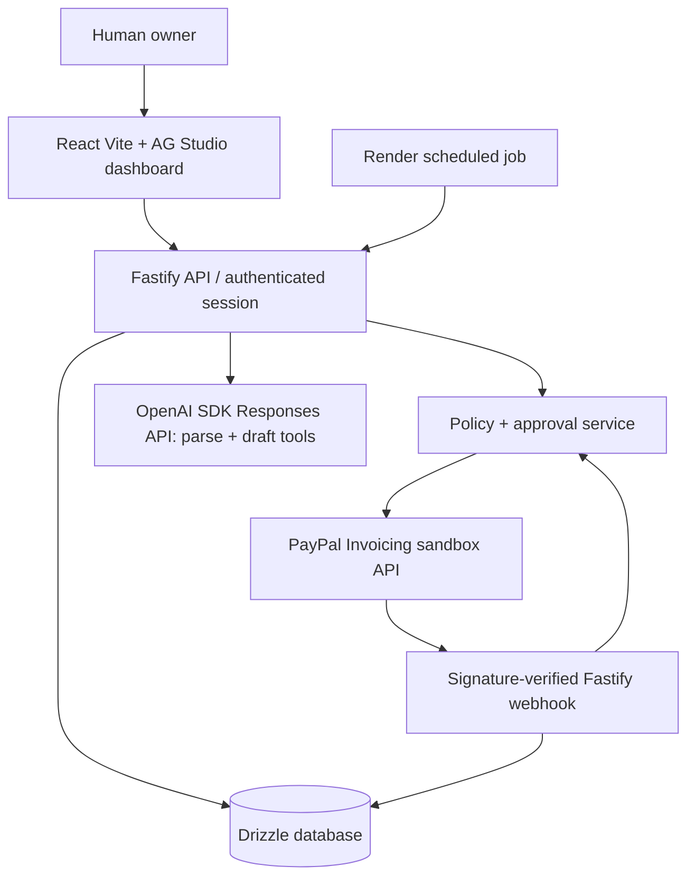

# NudgeMyInvoice — Proposed Architecture (NMI-P0)

Status: **planned; Phase 1 foundation in progress on a separate stacked branch**. Owner approves changes after independent review.

## Context / components


UI must **not** hold PayPal or AI secrets or call money-moving PayPal endpoints directly.

## Monorepo proposal
```text
apps/
  web/                   # React/Vite, dashboard, review, approval and status
  api/                   # Fastify routes, auth, webhook ingress
packages/
  shared/                # Zod contracts and ISO currency/decimal utilities
  domain/                # approval policy, invoice state machine, overdue logic
  db/                    # Drizzle schema, migrations, SQLite/Postgres adapters
  ai/                    # OpenAI tool allowlist, model fixtures, prompt adapters
  paypal/                # OAuth sandbox adapter, invoice reads/draft/send, webhook verification
  test-fixtures/         # synthetic, sanitized PayPal/model events
design/                   # retained project web design guidance, tokens and UI specs
docs/                     # product, architecture, status, security, testing, release
tasks/                    # bounded implementation and audit task contracts
scripts/                  # project profile validator, later stack commands
```

## State, data and trust boundaries
- Entities (proposed): `invoices`, `invoice_items`, `contacts` (synthetic MVP), `approvals`, `paypal_webhook_events`, `payment_observations`, `agent_runs`, `audit_log`.
- Every invoice has one currency code; persist amounts as strings/integers with currency-specific precision. No default FX conversion.
- A PayPal invoice ID uniquely maps to one local record; event IDs unique; errors/retries recorded.
- Human send/cancel/refund/etc. approvals bind actor, action, resource, amount/currency, canonical payload digest, expiry and idempotency key, with a state-machine that prevents double execution.
- PENDING/partial/paid/refunded states derive from validated PayPal observations; events trigger reconciliation, not blind monetary state mutation.
- Browser and agent messages are untrusted; validate at HTTP, service, PayPal and database boundaries.
- Webhook receiver preserves raw request bytes; verify source/signature and replay window, dedup event IDs in a transaction; simulator mocks are NEVER allowed to pass as real payment evidence.
- PayPal sandbox hostname is enforced server-side; no live environment fallback.

## Design-first flow
Before material UI work: `docs/PRODUCT.md` -> screen map and flows -> mockups and required states -> owner visual approval -> fixture-backed UI shell -> secure business/API wiring -> automated tests -> manual QA.

Suggested screens: Invoice dashboard (AG Grid); New invoice natural-language editor and structured preview; Approval details; Invoice detail/timeline; Overdue reminders and draft preview; Settings/sandbox status.

## Planned tech
- React, Vite, TS strict, AG Studio using the hackathon-linked 45-day trial. Implement a focused custom overdue widget when feasible. Verify exact license terms, key setup and post-trial demo availability; no unlicensed Enterprise redistribution.
- Fastify; Zod; Drizzle; PostgreSQL on Render, SQLite local **with dialect equivalence demonstrated**.
- Official `openai` Node SDK, Responses API structured output (`zodTextFormat`/`responses.parse`) with Zod re-validation of the result, server-side tool allowlist and deterministic model fixtures; model selected via `OPENAI_MODEL`, key via `OPENAI_API_KEY`. Single provider for the MVP.
- PayPal Invoicing REST sandbox, OAuth client credentials, verification endpoint or documented cryptographic validation; read-only agent-tool allowlist.
- Render web service/static assets, Postgres, cron/Workflows only if necessary for repeatable demo.
- GitHub PR checks using canonical project baseline plus project stack jobs once scaffold exists.

## Architecture constraints / phased scope
PayPal Invoicing is central for MVP; PayPal Orders/refunds are stretch only. The agent may propose actions, not execute privileged actions. APIMatic is coding-time API context. Scheduled overdue scanning creates drafts but never sends notifications. Evaluate local Postgres if maintaining two Drizzle dialects causes avoidable risk.

## Failure model
- AI fails/unavailable: manual entry fallback; no silently guessed payment/FX amounts.
- PayPal timeout: retry only with idempotency and reconciliation; never blind resend.
- Webhook forged/duplicate/out-of-order: reject or record non-mutating outcome; fetch authoritative state where needed.
- Scheduled worker duplicate: unique job/run keys; draft-only side effects.
- Render sandbox unavailable: local demo runbook and sanitized recorded fixtures, clearly labeled; no simulated payment claimed real.

## Deployment
Owner-approved sandbox-only Render service and database, with scoped environment secrets. Production PayPal hosts/credentials prohibited. Manual smoke verification and rollback documented in `docs/RELEASE.md`.

## Database dialect recommendation (NMI-P1, awaiting owner decision)
The committed schema (`packages/db`) is PostgreSQL only. Supporting SQLite locally as well would require a second Drizzle schema and migration set (different `bigint`, `date`, `jsonb`, partial-index and check-constraint behavior) plus parity tests for approval consume-once atomicity and webhook dedup, which are the correctness-critical paths. **Recommendation: use local PostgreSQL (e.g. Docker or a local install) for development and Render Postgres for deployment; drop SQLite.** This avoids dual-dialect maintenance inside the ~55-hour budget. The original plan is unchanged until the owner approves; `.env.example` still lists SQLite as the planned local default.

## Authentication, approvals and audit (NMI-P2-I1)
`apps/api` owns the HTTP boundary: `plugins/auth.ts` validates the session cookie against PostgreSQL (`PostgresAuthStore`) and is the only producer of `TrustedActor`; `routes/auth.ts` exposes `POST /api/auth/login`, `GET /api/auth/session`, `POST /api/auth/logout` plus public `GET /health`. `packages/db` holds the operator/session/audit schema (migrations `0002`, `0003`), `PostgresApprovalStore` (the real `ApprovalStore`), the audit sink and `requireApprovalAudited`. There is deliberately **no** approval-issuing or approval-executing route and no PayPal write path. The PostgreSQL-only choice is a prerequisite of this increment, not the owner's resolution of the SQLite question.

## Browser authentication and the same-origin `/api` contract (NMI-UI-01C1)
`apps/web` is a real client of exactly three routes: `GET /api/auth/session`, `POST /api/auth/login` and `POST /api/auth/logout`. All calls are relative same-origin URLs issued by one module (`src/auth/api.ts`); the browser manages the HttpOnly session cookie, and the CSRF token, operator identity and expiry live only in React memory (`src/auth/authState.ts`, `useAuthController.ts`). The server is the sole authority: nothing protected renders until `GET /api/auth/session` answers, a 401 at any later check or at local expiry drops the whole workspace (it is keyed by an auth epoch, so every in-memory draft is discarded), and a logout that is not confirmed by a 204 is reported as unconfirmed, never as completed. Invoice screens remain synthetic fixtures (labelled as such); no invoice, OpenAI or PayPal route is reachable from the browser.

**Origin contract.** The API accepts mutating requests only when `Origin` equals `WEB_ORIGIN` exactly, and answers credentialed CORS only for that origin. The browser therefore must call the API through the SAME origin as the page, via a reverse proxy that forwards `/api` (and keeps the browser's `Origin` header):

| Environment | Page origin = `WEB_ORIGIN` | Proxy |
| --- | --- | --- |
| `vite` dev server | `http://localhost:5173` | `server.proxy` in `apps/web/vite.config.ts` -> `http://127.0.0.1:3001` |
| `vite preview` (built bundle with the production CSP) | `http://localhost:4173` | `preview.proxy`, same target |
| Hosted (not yet authorized) | the one public HTTPS origin | any reverse proxy routing `/api/*` to Fastify on that origin; set `TRUST_PROXY=true` only behind it, so login throttling sees the client address |

The production CSP is `default-src 'none'; script-src 'self'; style-src 'self'; img-src 'self' data:; font-src 'self'; connect-src 'self'; form-action 'none'; base-uri 'none'`. The synthetic design-review preview (`App.tsx`) is reachable only from the dev server with `VITE_NMI_SYNTHETIC_PREVIEW=1`; production bundles contain neither it nor its simulated sign-in.

## Invoice drafts and PayPal sandbox drafts (NMI-P2-I2)
Flow: authenticated parse (`@nmi/ai`, advisory) -> operator-reviewed strict draft -> `PostgresInvoiceDraftStore.save` (single transaction, server-computed exact totals, audit in the same transaction) -> explicit `POST /api/invoice-drafts/:id/paypal-draft` -> `services/paypal-draft-service.ts` drives the durable `paypal_draft_operations` state machine (`pending -> creating -> created | rejected | unknown | mismatch`, fenced by `attempts`) through the `PayPalInvoicingReadDraft` port, implemented by `PayPalSandboxClient` (`packages/paypal`) over an injectable, allowlisted HTTP transport. Migration `0005` adds draft persistence columns, ordered items and the operations table; `0000`-`0004` are unchanged. Nothing in this flow sends, notifies or moves money; `PayPalInvoicingPrivileged` remains an unimplemented interface.

## Invoice list and owner-scoped reads (NMI-UI-01C4)
`GET /api/invoice-drafts` (read-only, `requireOperator`, `Cache-Control: no-store`) lists the authenticated operator's invoices: `{items:[{id,customerName,customerEmail,currency,dueDate,total,createdAt,paypal:{state}}], nextCursor}`. Query (strict): `limit` 1-50 (default 20), opaque `cursor`, `currency`, `status` (`none|progress|created|attention`), `q` (1-100 chars). Implemented by `PostgresInvoiceListStore` (`packages/db`): one `invoices LEFT JOIN paypal_draft_operations` query filtered by `created_by = $operator`, ordered `created_at DESC, id DESC`, keyset-paginated on `(created_at, id)` with a microsecond-exact cursor, `limit + 1` fetch to decide `nextCursor`. `paypal.state` comes only from the durable operation row (`none` when absent). The operator id comes from the server session, never the client. `GET /api/invoice-drafts/:id` uses `PostgresInvoiceDraftStore.getOwned(id, operatorId)`, so another operator's or an ownerless id is the same 404 as an unknown id. Fastify request logs keep the path only; note the HTTP request URL itself carries `q` (see `docs/SECURITY.md`, deployment prerequisite for proxy/ingress/CDN logs). The web client validates the page strictly (`domain/serverList.ts`) and renders it in `features/dashboard/RealDashboard.tsx`; the synthetic preview keeps the fixture dashboard. No migration was added.

## PayPal Sandbox draft panel (NMI-UI-01C5-P1)
The real saved-invoice page (`features/saved/SavedDetailScreen.tsx`) renders `PayPalDraftPanel` when the session provides `createPayPalDraft`. A POST to the existing `POST /api/invoice-drafts/:id/paypal-draft` is issued only from the confirm action of the accessible dialog (one request per confirmation, single flight, 60 s timeout = uncertain). The browser validates the answer strictly (`invoices/api.ts`): a success must be exactly `{paypalInvoiceId, status:"DRAFT", replayed}` with `201<->replayed:false` and `200<->replayed:true`; every documented error is matched by status and `error`; anything unverifiable is `uncertain`. After every answer the page re-reads `GET /api/invoice-drafts/:id`, which is the authority for the durable `paypal` state; "Check status" is that same read-only GET. The pure state machine (`invoices/paypalPanel.ts`) fails closed after EVERY POST answer: creation is blocked until a read-back bound to that confirmation (`seq`) has produced the exact invoice object being shown (a failed, malformed, stale or contradicting read never unlocks it; a `created` answer must be matched by durable `created` with the same id). A new explicit attempt is then offered only from durable `none`, `rejected` or `unknown`; `mapping-refused`, `disabled`, `not-found`, `forbidden` and `bad-request` lock creating for the view, a disabled server is never re-probed and `mismatch` offers no retry. The synthetic preview keeps its simulated panel and never receives the capability.
