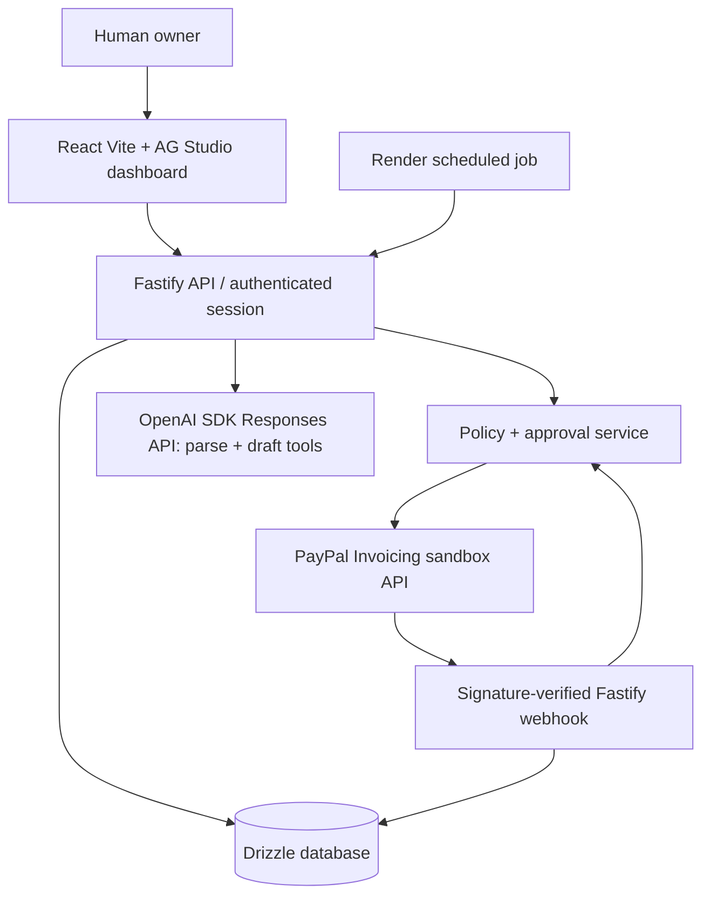

# NudgeMyInvoice — Proposed Architecture (NMI-P0)

Status: **planned; Phase 1 foundation in progress on a separate stacked branch**. Owner approves changes after independent review.

## Context / components


UI must **not** hold PayPal or AI secrets or call money-moving PayPal endpoints directly.

## Monorepo proposal
```text
apps/
  web/                   # React/Vite, dashboard, review, approval and status
  api/                   # Fastify routes, auth, webhook ingress
packages/
  shared/                # Zod contracts and ISO currency/decimal utilities
  domain/                # approval policy, invoice state machine, overdue logic
  db/                    # Drizzle schema, migrations, SQLite/Postgres adapters
  ai/                    # OpenAI tool allowlist, model fixtures, prompt adapters
  paypal/                # OAuth sandbox adapter, invoice reads/draft/send, webhook verification
  test-fixtures/         # synthetic, sanitized PayPal/model events
design/                   # retained project web design guidance, tokens and UI specs
docs/                     # product, architecture, status, security, testing, release
tasks/                    # bounded implementation and audit task contracts
scripts/                  # project profile validator, later stack commands
```

## State, data and trust boundaries
- Entities (proposed): `invoices`, `invoice_items`, `contacts` (synthetic MVP), `approvals`, `paypal_webhook_events`, `payment_observations`, `agent_runs`, `audit_log`.
- Every invoice has one currency code; persist amounts as strings/integers with currency-specific precision. No default FX conversion.
- A PayPal invoice ID uniquely maps to one local record; event IDs unique; errors/retries recorded.
- Human send/cancel/refund/etc. approvals bind actor, action, resource, amount/currency, canonical payload digest, expiry and idempotency key, with a state-machine that prevents double execution.
- PENDING/partial/paid/refunded states derive from validated PayPal observations; events trigger reconciliation, not blind monetary state mutation.
- Browser and agent messages are untrusted; validate at HTTP, service, PayPal and database boundaries.
- Webhook receiver preserves raw request bytes; verify source/signature and replay window, dedup event IDs in a transaction; simulator mocks are NEVER allowed to pass as real payment evidence.
- PayPal sandbox hostname is enforced server-side; no live environment fallback.

## Design-first flow
Before material UI work: `docs/PRODUCT.md` -> screen map and flows -> mockups and required states -> owner visual approval -> fixture-backed UI shell -> secure business/API wiring -> automated tests -> manual QA.

Suggested screens: Invoice dashboard (AG Grid); New invoice natural-language editor and structured preview; Approval details; Invoice detail/timeline; Overdue reminders and draft preview; Settings/sandbox status.

## Planned tech
- React, Vite, TS strict, AG Studio using the hackathon-linked 45-day trial. Implement a focused custom overdue widget when feasible. Verify exact license terms, key setup and post-trial demo availability; no unlicensed Enterprise redistribution.
- Fastify; Zod; Drizzle; PostgreSQL on Render, SQLite local **with dialect equivalence demonstrated**.
- Official `openai` Node SDK, Responses API structured output (`zodTextFormat`/`responses.parse`) with Zod re-validation of the result, server-side tool allowlist and deterministic model fixtures; model selected via `OPENAI_MODEL`, key via `OPENAI_API_KEY`. Single provider for the MVP.
- PayPal Invoicing REST sandbox, OAuth client credentials, verification endpoint or documented cryptographic validation; read-only agent-tool allowlist.
- Render web service/static assets, Postgres, cron/Workflows only if necessary for repeatable demo.
- GitHub PR checks using canonical project baseline plus project stack jobs once scaffold exists.

## Architecture constraints / phased scope
PayPal Invoicing is central for MVP; PayPal Orders/refunds are stretch only. The agent may propose actions, not execute privileged actions. APIMatic is coding-time API context. Scheduled overdue scanning creates drafts but never sends notifications. Evaluate local Postgres if maintaining two Drizzle dialects causes avoidable risk.

## Failure model
- AI fails/unavailable: manual entry fallback; no silently guessed payment/FX amounts.
- PayPal timeout: retry only with idempotency and reconciliation; never blind resend.
- Webhook forged/duplicate/out-of-order: reject or record non-mutating outcome; fetch authoritative state where needed.
- Scheduled worker duplicate: unique job/run keys; draft-only side effects.
- Render sandbox unavailable: local demo runbook and sanitized recorded fixtures, clearly labeled; no simulated payment claimed real.

## Deployment
Owner-approved sandbox-only Render service and database, with scoped environment secrets. Production PayPal hosts/credentials prohibited. Manual smoke verification and rollback documented in `docs/RELEASE.md`.

## Database dialect recommendation (NMI-P1, awaiting owner decision)
The committed schema (`packages/db`) is PostgreSQL only. Supporting SQLite locally as well would require a second Drizzle schema and migration set (different `bigint`, `date`, `jsonb`, partial-index and check-constraint behavior) plus parity tests for approval consume-once atomicity and webhook dedup, which are the correctness-critical paths. **Recommendation: use local PostgreSQL (e.g. Docker or a local install) for development and Render Postgres for deployment; drop SQLite.** This avoids dual-dialect maintenance inside the ~55-hour budget. The original plan is unchanged until the owner approves; `.env.example` still lists SQLite as the planned local default.

## Authentication, approvals and audit (NMI-P2-I1)
`apps/api` owns the HTTP boundary: `plugins/auth.ts` validates the session cookie against PostgreSQL (`PostgresAuthStore`) and is the only producer of `TrustedActor`; `routes/auth.ts` exposes `POST /api/auth/login`, `GET /api/auth/session`, `POST /api/auth/logout` plus public `GET /health`. `packages/db` holds the operator/session/audit schema (migrations `0002`, `0003`), `PostgresApprovalStore` (the real `ApprovalStore`), the audit sink and `requireApprovalAudited`. There is deliberately **no** approval-issuing or approval-executing route and no PayPal write path. The PostgreSQL-only choice is a prerequisite of this increment, not the owner's resolution of the SQLite question.
